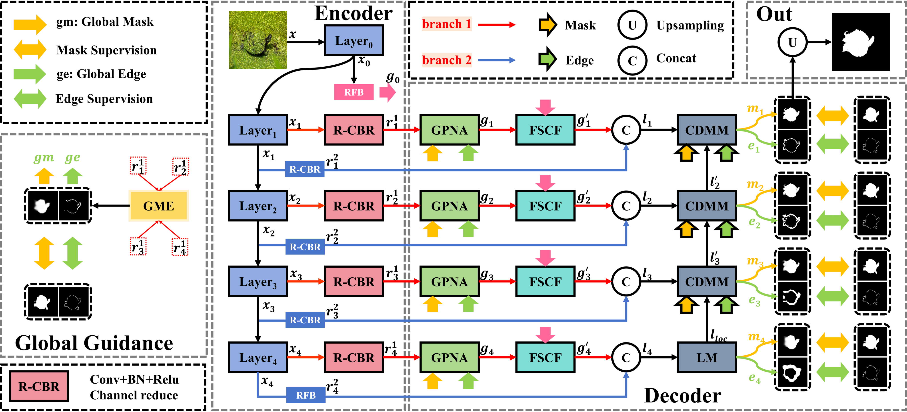

<div align="">

---

> **UWCOSNet: Underwater camouflaged object segmentation network with frequency edge enhancement**, accepted by ***Applied Soft Computing (ASOC), 2026**.

## 🔥 News

* **[2026.10]** 🎉 Create repository and release the training, inference, and evaluation codes!
* **[2026.10]** 🎉 Our paper has been accepted by **Applied Soft Computing (ASOC)**!

---

## ✨ Overview & Architecture

<div align="center">
  <!-- 将 assets/framework.png 替换为你仓库里的模型结构图路径 -->
  
</div>

<br>

**Keywords:** Underwater camouflaged object segmentation; Frequency enhancement; Edge guidance; Adaptive fusion

---

## 🛠️ Environment Setup

The code has been tested on Ubuntu / Windows with NVIDIA GPUs and CUDA.

```bash
# 1. Clone this repository
git clone https://github.com/xuhan199606/UWCOSNet.git
cd UWCOSNet

# 2. Create and activate conda environment
conda create -n xxnet python=3.9 -y
conda activate xxnet

# 3. Install PyTorch (adjust CUDA version according to your hardware)
pip install torch==2.0.1 torchvision==0.15.2 --index-url [https://download.pytorch.org/whl/cu118](https://download.pytorch.org/whl/cu118)

# 4. Install other dependencies
pip install -r requirements.txt
```

---

## 📂 Dataset Preparation

### 1. Download Links

In our experiments, we select the MAS3K-CAM training set as the
only training source for all evaluated methods. The MAS3K-CAM test
set and Aqua-Test are used to evaluate underwater segmentation perfor
mance, while CAMO, CHAMELEON, COD10 K, and NC4 K are reserved
for assessing direct transfer to general COS scenes.
Please download the training and testing datasets from the following links:

| Dataset             |                                      Ref.                                      | Google Drive |    Baidu Netdisk (百度网盘)    |
| :------------------ | :-----------------------------------------------------------------------------: | :----------: | :-----------------------------: |
| **MAS3K-CAM** |              [Paper](https://ieeexplore.ieee.org/document/9471801/)              | [Download](https://drive.google.com/drive/folders/1up9wXeWMxHiAhy0156qhu9UkdncQzf04?usp=sharing) | [Download](https://pan.baidu.com/s/197StNl8ryFbkAAfhm47ZXQ?pwd=8723) (提取码: `8723`) |
| **Aqua-Test** |               [Paper](https://doi.org/10.1007/s11227-024-06584-x)               | [Download](https://drive.google.com/drive/folders/1up9wXeWMxHiAhy0156qhu9UkdncQzf04?usp=sharing) | [Download](https://pan.baidu.com/s/197StNl8ryFbkAAfhm47ZXQ?pwd=8723) (提取码: `8723`) |
| **CAMO**      |   [Paper](https://www.sciencedirect.com/science/article/pii/S1077314219300608)   | [Download](https://drive.google.com/drive/folders/1up9wXeWMxHiAhy0156qhu9UkdncQzf04?usp=sharing) | [Download](https://pan.baidu.com/s/197StNl8ryFbkAAfhm47ZXQ?pwd=8723) (提取码: `8723`) |
| **CHAMELEON** | [Link](https://www.polsl.pl/rau6/chameleon-database-animal-camouflage-analysis/) | [Download](https://drive.google.com/drive/folders/1up9wXeWMxHiAhy0156qhu9UkdncQzf04?usp=sharing) | [Download](https://pan.baidu.com/s/197StNl8ryFbkAAfhm47ZXQ?pwd=8723) (提取码: `8723`) |
| **COD10K**    |          [Paper](https://ieeexplore.ieee.org/abstract/document/9156837)          | [Download](https://drive.google.com/drive/folders/1up9wXeWMxHiAhy0156qhu9UkdncQzf04?usp=sharing) | [Download](https://pan.baidu.com/s/197StNl8ryFbkAAfhm47ZXQ?pwd=8723) (提取码: `8723`) |
| **NC4K**      |          [Paper](https://ieeexplore.ieee.org/abstract/document/9577641)          | [Download](https://drive.google.com/drive/folders/1up9wXeWMxHiAhy0156qhu9UkdncQzf04?usp=sharing) | [Download](https://pan.baidu.com/s/197StNl8ryFbkAAfhm47ZXQ?pwd=8723) (提取码: `8723`) |

### 2. Directory Organization

After downloading and unpacking, please organize the dataset directory as follows:

```text
├── datasets/
│   ├── TrainDataset/
│   │   ├── Images/
│   │   └── Mask/
│   └── TestDataset/
│       ├── Images/
│       └── Mask/
```

---

## 📊 Model Zoo & Pre-computed Predictions

To facilitate future comparison, we provide the **pre-trained weights** as well as the **pre-computed prediction maps** on all benchmark datasets:

- **pre-trained weights** : ResNet50 and PVTv2-B2 ([Google Drive](), [Baidu Netdisk (百度网盘)]()).

- **finall weights** : UWCOSNet-ResNet50 and UWCOSNet-PVTv2-B2 ([Google Drive](), [Baidu Netdisk (百度网盘)](https://pan.baidu.com/s/1VozDXpUBddHbd1w28Kkrhg?pwd=8723)(提取码: `8723`)).

- **prediction maps**: UWCOSNet-ResNet50 and UWCOSNet-PVTv2-B2 and other methods

---

## 🚀 Training, Inference & Evaluation

### 1. Model Training

```bash
python -W ignore Train.py   --epoch 100 --lr 1e-4 --optimizer Adam --batchsize 1 --trainsize 352 \
                            --train_path .../MAS3K-Camouflaged/train \
                            --test_path .../MAS3K-Camouflaged/test \
                            --datasets_name mas3kcam \
                            --model_name UWCOSNet_PVTv2B2
```

### 2. Model Inference / Prediction 

Generate prediction maps using the trained model weights:

```bash
python -W ignore Test.py --testsize 352 \
                         --pth_path "path to UWCOSNet_PVTv2B2.pth" \
                         --data_path .../MAS3K-Camouflaged/test \
                         --model_name UWCOSNet_PVTv2B2 \
                         --save_path "path to save" \
                         --data_name  mas3kcam
```

### 3. Metric Evaluation 

Evaluate quantitative metrics ($S_\alpha$, $E_\phi$, $F_\beta^\omega$, $\text{MAE}$, etc.) between the generated prediction maps and Ground Truth:

```bash
python -W ignore Eval.py --mask_root "path to Mask" \
                         --pred_root "path to Prediction" \
                         --save_path "path to save json"
```

---

## 🖊️ Citation

If you find our work, code, or pre-computed results useful in your research, please consider citing our paper and giving this repo a ⭐ **Star**:

```bibtex
@article{HAN2027116609,
title = {UWCOSNet: Underwater camouflaged object segmentation network with frequency edge enhancement},
journal = {Applied Soft Computing},
volume = {204},
pages = {116609},
year = {2027},
issn = {1568-4946},
doi = {https://doi.org/10.1016/j.asoc.2026.116609},
url = {https://www.sciencedirect.com/science/article/pii/S1568494626020570},
author = {Xu Han and Bo Wang and Shengyuan Luo and Shuo Xu and Ye Li},
}

```

---

## 📧 Contact & Reference

* **Contact:** If you have any questions about the code or paper, please feel free to open an **Issue** or contact **Xu Han** via email at **hxheu@hrbeu.edu.cn**.
* **Code Reference:** 
    - https://github.com/pytorch/vision/
    - https://github.com/DengPingFan/SINet
    - https://github.com/whai362/PVT
    - https://github.com/DengPingFan/Polyp-PVT


---

<!-- ## ⭐ Star History

[](https://star-history.com/#xuhan199606/UWCOSNet&Date) -->
